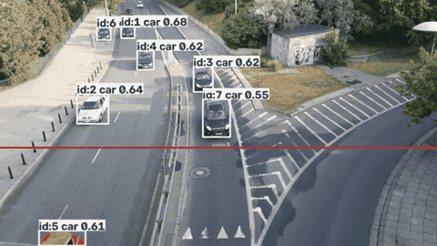

# Sentra

Real-time vehicle detection, tracking and counting from road video. Every vehicle that crosses a virtual line is counted once, split by direction and vehicle type, stored in SQLite, served by a small API and shown on a dashboard.



## How it works

```
video -> YOLO (nano) detects -> ByteTrack gives each vehicle an ID -> line-crossing check
      -> SQLite (data/sentra.db) -> FastAPI (api.py) -> Streamlit dashboard (dashboard.py)
```

- **Detection:** Ultralytics YOLO nano, restricted to car, motorcycle, bus and truck.
- **Tracking:** ByteTrack keeps the same ID for a vehicle across frames.
- **Counting:** for each ID, compare its previous and current center against a horizontal line (`counting.py`). A change of side is a crossing. Each ID is counted once. Direction is `toward` or `away` from the camera.
- **Storage:** one row per crossing (time, track id, direction, vehicle type).

## Project layout

```
count.py        main pipeline: video in, counts out (SQLite, optional GIF)
counting.py     the line-crossing rule
db.py           SQLite helpers
api.py          FastAPI endpoints
dashboard.py    Streamlit dashboard
label.py        tool for hand-counting a video (ground truth)
evaluate.py     compares system counts with the hand count
tests/          pytest tests
docs/           demo GIF and a small sample database
```

## Setup

```
python -m venv venv
venv\Scripts\activate                              # Windows
python -m pip install -r requirements-pipeline.txt
```

Put a road video next to the code as `traffic.mp4` (videos and model files are not in the repo).

## Run

```
python count.py --show                 # process the video with a live window (q to quit)
python count.py --gif docs/demo.gif    # save a preview GIF
uvicorn api:app --reload               # API, docs at http://127.0.0.1:8000/docs
streamlit run dashboard.py             # dashboard (use a second terminal)
python -m pytest                       # tests
```

Useful options for `count.py`: `--video`, `--line-y 0.58` (line height as a fraction of frame height), `--conf`, `--imgsz`.

API: `GET /runs`, `GET /counts`, `GET /events?limit=100`.

## Measuring accuracy

Use two windows of the same clip so tuning does not flatter the result:

- **Dev window** (0-60 s): look at the output freely and tune `--line-y` and `--conf` here.
- **Test window** (60-140 s): hand-count it first, never tune on it, and report this number.

Labeling rules (decide them before you start, then keep them): a vehicle counts when its center passes the line. `car` = passenger cars and vans, `truck` = lorries, `bus` = buses. Write the rules you used in the results below.

```
python label.py --video traffic2.mp4 --line-y 0.6 --start-s 60 --end-s 140 --out data/gt_test.csv
python count.py --video traffic2.mp4 --line-y 0.6 --start-s 60 --end-s 140
python evaluate.py --truth data/gt_test.csv --start-s 60 --end-s 140
python evaluate.py --truth data/gt_test.csv --start-s 60 --end-s 140 --ignore-type
```

`label.py` keys are listed at the top of the file. `evaluate.py` reports the count error, correct / missed / extra crossings, precision and recall. A crossing with the wrong vehicle type counts as one miss and one extra, so the `--ignore-type` run shows how good the counting is apart from classification.

## Results

**Not yet measured.** The accuracy number must come from the hand-counted test window (60-140 s of `traffic2.mp4`). Fill in this table when you have it:

| Matching on | Hand count | System count | Correct | Missed | Extra | Precision | Recall |
|---|---|---|---|---|---|---|---|
| direction only | | | | | | | |
| direction + type | | | | | | | |

Dev window (0-60 s) sanity run, not an accuracy figure: 77 crossings counted (57 car, 16 truck, 4 bus, one of them wrongly counted as moving away). Several vans were labelled truck or bus, and one large lorry partly in view was counted as an "away" bus.

## Deploy the dashboard (Streamlit Community Cloud)

The root `requirements.txt` holds only the dashboard libraries, so the cloud build stays small. The dashboard falls back to `docs/sample.db` when there is no local database, so the deployed page shows data.

1. Push the repo to GitHub.
2. Sign in at Streamlit Community Cloud with GitHub, choose **Create app**, pick this repo, branch `main`, and main file `dashboard.py`.
3. Deploy.

Streamlit's docs say Python requirements files go in the repo root or next to the entrypoint, and that paths must use forward slashes. See https://docs.streamlit.io/deploy/streamlit-community-cloud/deploy-your-app/app-dependencies for details.

## Known failure cases

- Auto-rickshaws are not a class in the COCO dataset the model learned from, so they get labelled as another vehicle (seen once as "truck") when far from the camera.
- Vans are labelled "truck" or "bus" because the COCO classes have no van.
- A very large vehicle that is only partly in view can make its center jump and be counted in the wrong direction or type.
- Far-away vehicles get many short-lived IDs (ID numbers pass 1000 within a minute), which is harmless for counting only because they never reach the line.
- Brief ghost detections lasting a few frames at the default confidence threshold.
- Vehicles already inside the frame when the video starts can be missed if they never cross the line after tracking begins.
- Vehicles that leave the frame sideways before reaching the line are not counted.
- A 4K frame is shrunk for the detector, so far-away vehicles are tiny and detected late.

## Roadmap

- Evaluation on a longer, busier clip with a hand-counted ground truth.
- Tune `conf` and the line position using that data.
- Fine-tune on Indian vehicle types (auto-rickshaw).
- Speed estimation, night footage.
